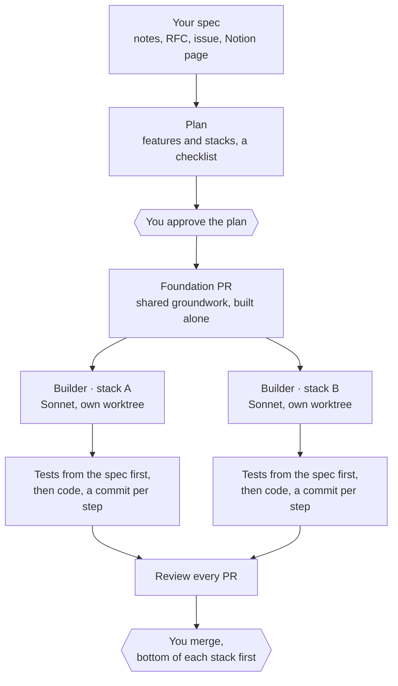
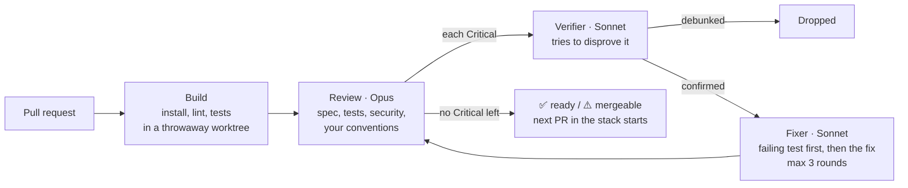

# Executor

**Give it a spec. Get back a stack of reviewed pull requests.**

Executor is a free Claude Code plugin that runs the engineer's loop for you. It plans a spec into features and builds them in parallel. It reviews every PR against your spec and your repo's conventions, checks its own findings, and fixes the bugs it confirms. The merge stays with you.

You approve twice: the plan, and the merge.

[](LICENSE)


```
/plugin marketplace add sebwilgosz/agent-plugins
/plugin install executor@engineer-of-wealth
```

[How it works](#how-it-works) · [What it costs](#what-it-costs) · [What it never does](#what-it-never-does) · [Commands](#commands) · [Install](#install) · [FAQ](#faq) · [Reference](#reference)

---

## What you get

At the end of a build you get one block, not a wall of logs:

```text
Executor build · billing export
Stack A: #41 ✅ · #42 ✅ · #43 ⚠️
Stack B: #44 ❌ 1 Critical open
Suggestions: 23 across 4 PRs
Reviews:
  - https://github.com/acme/api/pull/41#issuecomment-…
Open:
  - #44: the spec says invoices are monthly, the test says weekly. Which one?
Merge: #41, #42, #43, then #44 once fixed
```

Each PR is a draft in a [GitHub stack](https://github.com/github/gh-stack), with a few bullets, a diagram when the change has a shape, and a Testing section. Before you see it, each one has passed your build, your tests and a review.

## How it works



Every PR gets the same review, whether Executor built it or you did:



The design rules behind it:

- **Opus where judgement lives, Sonnet everywhere else.** Each PR gets one Opus review. Orchestration, building, verifying and fixing run on Sonnet.
- **Deterministic work is a script, not a model turn.** Opening a PR, applying verdicts, waiting for CI and printing status are shell scripts. The model only does the parts that need reasoning.
- **Tests come from the spec, before the code.** The builder can't quietly redefine "done".
- **Findings are checked before anyone acts on them.** Each Critical finding gets its own agent whose only job is to prove it wrong. Across 315 verifier runs so far, it debunked 18 findings and downgraded 47.
- **The machine tests, the model reads.** With CI configured, the suite runs on GitHub while the review reads the diff.

## What it costs

These numbers come from real builds and count the main thread plus every subagent, at API list prices: Opus $4 in / $20 out, Sonnet $2 / $10 per million tokens, cache reads $0.20.

**On the current setup (0.13.x), one reviewed pull request costs $2.18 to $2.58.**

| Build | PRs | Total | Per PR |
|---|---|---|---|
| Executor's own review-cost release | 4 | $9.69 | $2.42 |
| `gh stack` exit codes | 1 | $2.53 | $2.53 |
| A new plugin skill | 1 | $2.58 | $2.58 |
| A plugin setup flow (no builder or fixer ran) | 1 | $2.18 | $2.18 |

Where the money went on the 4-PR build:

| Role | Model | Per PR |
|---|---|---|
| Reviewer | Opus | $0.95 |
| Orchestrator (plan, spawn, report) | Sonnet | $0.71 |
| Builders, verifiers, fixers | Sonnet | $0.76 |

How the cost per PR changed across versions:

| Version | What changed | Per PR |
|---|---|---|
| 0.10.0 | Every review ran inline in one Opus thread (9 PRs) | $1.87 |
| 0.12.0 | Tests run in CI, not in model turns (3 PRs, no bugs found) | $1.43 |
| 0.13.0 | Reviews moved to their own Opus agents, orchestrator still on Opus | $2.33 to $3.13 |
| 0.13.x | Orchestrator moved to Sonnet | $2.18 to $2.58 |

Before you rely on these numbers:

- **The sample is small.** It covers eleven builds, mostly 1 to 4 PRs each and mostly in Markdown-and-shell repos. Your repo will differ.
- **Small builds look worse per PR.** Reading the spec and planning cost about the same for 1 PR as for 9.
- **The cheapest build found no bugs,** so no verifier or fix round ran. When every PR has a Critical, every PR pays for a fix round.
- **On a Claude subscription** you pay in usage limits, not dollars. The ratios between roles stay the same.

Each release that changes the cost adds a row here.

## What it never does

- **Never merges.** You do.
- **Never edits a test to make it pass.**
- **Never force-pushes**, and never touches a PR from a fork.
- **Never fixes someone else's PR.** On a teammate's PR or branch it only reports.
- **Never posts to GitHub** unless you turn that on.
- **Never commits plans or specs to your repo**, unless you say your specs live there.
- **Never builds in your checkout.** Builders and reviews each use their own worktree.

## Commands

| Command | What you get |
|---|---|
| `/executor:spec` | A spec drafted from your notes and the repo, saved where your specs live |
| `/executor:build` | A spec planned with you and built in parallel: one reviewed draft PR per feature, in stacks |
| `/executor:review` | A PR or branch built, reviewed and its bugs fixed, even in another repo |
| `/executor:ship` | The current branch committed, pushed and opened as a draft PR |
| `/executor:status` | What to merge now, across every repo |
| `/executor:init` | Setup |
| `/executor:help` | What Executor does, and the right command for what you type |

You can also ask in plain words: "build docs/rfc-12.md", "review acme/api#7", "where are my builds".

## Install

In Claude Code:

```
/plugin marketplace add sebwilgosz/agent-plugins
/plugin install executor@engineer-of-wealth
```

Then type `/executor:init`. It checks the GitHub CLI, its sign-in and the [gh-stack](https://github.com/github/gh-stack) extension, offering to install it. In a build repository it offers to enable Executor in the committed `.claude/settings.json`, merged in without touching your other settings, so every worktree inherits it. It asks for your [search roots](#search-roots), [plans folder](#where-plans-live) and [spec home](#where-specs-live), then ends with a setup check, `scripts/self-audit.sh`, that you can rerun any time.

**Requirements**

- [Claude Code](https://claude.com/claude-code)
- [GitHub CLI](https://cli.github.com) (`gh`), signed in
- For stacked PRs: the [gh-stack](https://github.com/github/gh-stack) extension (`gh extension install github/gh-stack`) and stacked PRs enabled on the repository. Without them, Executor opens plain PRs chained by base branch.
- `jq` is used when present; the hook works without it

## FAQ

**Is it free?** Yes, under the MIT license. You pay for your own Claude usage.

**Does it work with my language or framework?** It builds and tests with your repo's own commands, which it finds in `CLAUDE.md`, `AGENTS.md`, `CONTRIBUTING.md` or the README. It reviews against your linter configs and the code around the change.

**What if my spec is thin?** It asks questions before it builds anything, each with a suggested answer. If you have no spec at all, `/executor:spec` drafts one from your notes and the repo.

**What if a builder gets stuck?** Only its own stack stops while it asks you. The other stacks keep going.

**Can I use only the review?** Yes. `/executor:review` works on any PR, including ones you wrote by hand, and starts on its own when Claude opens a PR.

**Where do my specs live?** Where they already live: Notion, a vault note, a GitHub issue, a folder. Executor learns which from your `AGENTS.md` or `CLAUDE.md`. See [Where specs live](#where-specs-live).

---

## Reference

The details behind each command and setting.

### Spec and build

Type `/executor:spec` with your notes for a spec, then type `/executor:build` with it (a path, URL, issue or the text), or ask in plain words ("build docs/rfc-12.md"). A thin spec gets questions, each with a suggested answer, before anything is built.

1. **Plan.** Executor splits the spec into features and stacks and writes a checklist, one item per feature, linked to the spec. You approve it.
2. **Foundation.** Shared groundwork (schema, auth, skeleton) is built alone first. Merge its PR and run `/executor:build` again.
3. **Build.** One `executor:builder` agent per stack, on Sonnet, in parallel, each in its own worktree with only its feature's requirements. It first writes tests from the spec (manual scenarios where a test can't be automated) so the code can't drift, then builds in the repo's patterns, a commit per step.
4. **Open.** Once the spec tests and the build pass, the feature becomes a draft PR in a GitHub stack, on top of the one it depends on: a few bullets, a diagram when the change has a shape, and a Testing section. A needed refactor gets its own PR below.
5. **Review.** Every PR is [reviewed](#review). A ✅ or ⚠️ marks it ready and starts the next feature of its stack. A builder stuck on a question stops only its stack.
6. **Report.** One block: each stack, the open questions, and what to merge, bottom of each stack first. Run `/executor:build` again to carry on.

#### Tickets

When the spec home names a tracker (`Tickets: GitHub`, `Jira project TRAV`, `Linear`), build offers, after you approve the plan, one ticket per plan item: a sub-issue of the spec's parent issue on GitHub, or via your Linear or Jira connector. It holds the builder's brief and a spec link; the PR closes it (`Closes #n`, or the key). A rerun never duplicates one; an unreachable tracker never stops the build.

### Review

Type `/executor:review` with a PR number or URL, a branch, or nothing for the current branch. It also starts on its own when Claude opens a PR or you ask for one. An `executor:reviewer` agent (Opus) does the build and the review and writes the draft to a file, so a long review never fills your session; an `executor:fixer` agent (Sonnet) does the fixing. Five steps:

1. **Build.** Install, build, lint and tests, with your repo's commands, must pass. A PR is built in a throwaway worktree, never in yours.
2. **Review** the diff for duplication, correctness against your spec, test coverage, security, best practices (including needless inline comments) and your repo's conventions (`CLAUDE.md`, `AGENTS.md`, `CONTRIBUTING.md`, linter configs, the code around). A doc the diff makes false, like a removed flag, is Critical and gets corrected.
3. **Verify.** Each Critical finding goes to its own `executor:verifier` agent, on Sonnet, which tries to disprove it. Debunked ones are dropped, by a script, so no agent is spawned for that.
4. **Fix**, on your own PRs, only when a Critical finding is confirmed (otherwise no fixer runs). A confirmed Critical finding is a bug: Executor writes the failing test, fixes it, commits and reviews again, at most three rounds, without new agents. It never edits a test to make it pass, never force-pushes and never touches a PR from a fork. On a teammate's PR or someone else's branch it only reports. `--fix` and `--no-fix` override that; a fork stays report-only.
5. **Report**, always in the same shape: verdict, build, CI, spec, mode and bugs fixed, then what is still Critical and the Suggestions. Each finding links to the line, says when it fails and how to fix it.

Suggestions are listed as drafted, never verified or fixed. Nothing is posted to GitHub unless you ask.

On ✅ or ⚠️ your own draft PR, one opened by hand too, is marked ready. A review by branch does so only when it saw exactly the PR's head commit, nothing uncommitted. A teammate's draft stays a draft, as does yours under `--no-fix`.

Every PR Claude opens is assigned to you, a stacked one once its head branch matches what `gh stack` reported.

#### Review from any folder

In any session, name another repository's PR as `owner/repo#N` or by URL: "let's review acme/api#7". A bare number or a branch name always means the current repository. A review runs in the repository's own checkout. If the current folder's `origin` is that repository, it reviews here. Otherwise:

1. **Find the checkout** under your [search roots](#search-roots), two levels deep. A bare repository with its worktrees (`~/Projects/api/main`) counts as one.
2. **Update it.** It fetches `origin` and fast-forwards the default branch only where checked out clean. Uncommitted work, local commits and the branch someone is on are left alone; the review works from `origin/<default>`.
3. **Hand off.** It proposes a new session there running the review, or prints the command:

   ```
   cd "/home/you/Projects/api" && claude "/executor:review https://github.com/acme/api/pull/7"
   ```

4. **No checkout.** It asks before cloning into the first root (`gh repo clone acme/api ~/Projects/api`). On no, nothing is cloned.

### Status

Type `/executor:status`, or ask "where are my builds". It reads every live plan and its PRs:

```
EXECUTOR STATUS

acme/api
  2026-11-07 - billing export
    MERGE NOW
      #31  CSV export                 Stack A 1/2   CI green   review ready
    WAITING ON YOU
      #32  Invoice emails             Stack B 1/1   CI red     review ready
    MOVING
      Stack A: 1 not started
```

The bare command needs no model turn; text after it ("what blocks acme/api?") is answered from the same output. It only reads: it never marks a plan, pushes or posts.

- A finished, unmarked plan ends with `finished, not marked: run scripts/plan-sweep.sh`.
- Executor's own leftover worktrees and branches from finished builds show as a `DRIFT` line with the clearing command, `scripts/repo-tidy.sh <repo>`. Your own branches and a finished-branch checkout are not drift. `scripts/self-audit.sh -v` reports the same for the current repo.

### Settings

#### Search roots

Where Executor looks for checkouts, in order, in `~/.engineer-of-wealth/executor/config.md`. Default `~/Projects`; the setup check warns about a missing root:

```markdown
## Roots
- ~/Projects
- ~/code
```

#### Where plans live

Plans never go in your repository. Each is a dated file in one folder per repository, shared by its worktrees:

```
~/.engineer-of-wealth/executor/plans/<org>/<repo>/<YYYY-MM-DD> - <title>.md
```

`<org>/<repo>` comes from the `origin` URL, or is `local/<name>` without one. A plan is live until its header says `Status: done <date>`, added once every item's PR is merged or closed. `scripts/plan-sweep.sh` does that for every repository at once; `--dry-run` only shows. Finished plans stay put; there is no archive step.

To move plans, init writes a `## Plans` section in `config.md`; the `EXECUTOR_PLANS` environment variable wins over it. Moving it moves nothing: init prints the `mv` to run. `/executor:help` shows the folder, its source and live plans. For a notes app, link the folder: `ln -s ~/.engineer-of-wealth/executor/plans ~/Notes/plans`.

Older plans in a repository's legacy `.executor/` folder move on its first build. `scripts/plans-migrate.sh` moves every one under `~/Projects`, or the folder you name (`--dry-run` only shows). It never overwrites: a clash is reported and that file stays.

#### Where specs live

A spec may be a Notion RFC, a vault note or a GitHub issue. Executor never decides where; it reads a short section from the nearest `AGENTS.md` or `CLAUDE.md`, from your working folder upwards, then the target repo's own:

```markdown
## Specs
Specs: Notion, the "RFCs" database. Tickets: Jira project TRAV.
```

Others: `Specs: GitHub, a parent issue in this repo` and `Specs: docs/specs/ in this repo`, the only case where a spec is committed. `scripts/self-audit.sh -v` names the file in use.

Where nothing names a home, init asks once and writes the section only on a yes, uncommitted. Declined, specs stay in `~/.engineer-of-wealth/executor/specs/<org>/<repo>/`.

### Faster worktrees and commit checks

Optional, per repo; the clones need macOS with APFS:

```
bash <plugin root>/scripts/git-hooks.sh install <repo>
```

- **New worktree:** `node_modules` and `.next/cache` are cloned from the main checkout, for each package up to two folders down, at almost no disk cost; bare repos work too. If it has none, install there once.
- **After a commit:** the type check and lint of each touched package run, up to 60 seconds each. Errors print; the commit stands. Markdown- or image-only commits run nothing.
- **Is it on:** `git-hooks.sh status <repo>` prints `HOOKS: installed` only when the post-commit hook is in place, not bypassed by `core.hooksPath`, and a package has a lint or type check to run; otherwise `HOOKS: off`. It changes nothing.
- **Off again:** `git-hooks.sh uninstall <repo>` removes only what `install` wrote. Another tool's hook is never overwritten, and a repo with `core.hooksPath` set is left alone.

## Contributing

Executor holds itself to the rules in [CONTRIBUTING.md](CONTRIBUTING.md), and its own review reads that file as a conventions source. Every change is listed in the [CHANGELOG](CHANGELOG.md).

## License

MIT. Built by [Sebastian Wilgosz](https://sebwilgosz.com).
